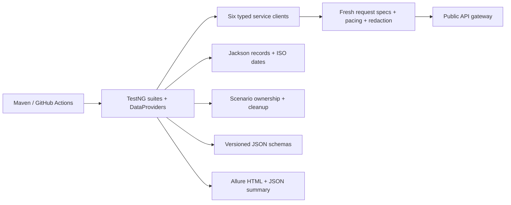

# Rest Assured Java API Automation

[](https://github.com/srenevasanks/rest-assured-java-api-automation/actions/workflows/api-automation.yml)

I built this framework to test the public [Restful Booker Platform](https://automationintesting.online/) through its deployed APIs. It exercises persisted business workflows across rooms, bookings, messages and reporting, alongside authentication, negative inputs, authorization and published JSON contracts.

The project contains **61 meaningful test invocations**. Actual results, including unresolved application and documentation failures, are recorded in [execution summary](docs/execution-summary.md). I keep those failures enabled rather than publishing an artificial green regression.

## Start here

Use Java 17 and Maven 3.9+. Set `JAVA_HOME` to the Java 17 installation and put Maven on PATH. Supply `API_USERNAME` and `API_PASSWORD` as environment variables using the public test account published in the [application README](https://github.com/mwinteringham/restful-booker-platform#login). Credentials and runtime tokens are not committed. Configure the same two names as GitHub repository Actions secrets.

From the repository root:

```shell
mvn clean test
mvn clean test -DsuiteXmlFile=src/test/resources/suites/smoke.xml
mvn clean test -DsuiteXmlFile=src/test/resources/suites/regression.xml
mvn clean test -DsuiteXmlFile=src/test/resources/suites/contract.xml
mvn clean test -DsuiteXmlFile=src/test/resources/suites/integration.xml
mvn allure:report
mvn allure:serve
```

Each `clean` removes the previous `target` results. Generate or archive the report before starting another scope. The machine-readable run summary is `target/execution-summary.json`; Surefire evidence is under `target/surefire-reports`; Allure raw results are under `target/allure-results`; generated HTML is `target/site/allure-maven-plugin/index.html`. The delivered report snapshot is `reports/allure-html/index.html`. Serve Allure over HTTP using the verified command described in [execution summary](docs/execution-summary.md).

The full regression and contract commands currently exit nonzero for the documented external failures. Smoke and integration results are reported separately. No retry analyzer, disabled defect tests, `continue-on-error`, or forced-success exit code conceals failures.

## Stack and organization

Java 17, Rest Assured 5.5.6, TestNG 7.11.0, Maven, Jackson 2.18.3, Rest Assured JSON Schema Validator, Allure TestNG 2.29.1 / report 2.32.0, SLF4J and Logback. Dependency versions are pinned in `pom.xml`. UUID-based synthetic fixtures are the test-data generator; they avoid adding a large Faker dependency for a few bounded fields. Source is formatted with Google Java Format.



`src/main/java/framework` contains configuration, clients, authentication, models, data, specifications and JSON utilities. `src/test/java/tests` contains assertions, service tests and the ownership/reporting support. Tests have no ordering dependencies. A workflow finishes its dependent lifecycle within one invocation to reduce public-reset exposure.

## What I validate

| Service | Coverage |
|---|---|
| Auth | Login, validation, token reuse, invalid/missing credentials and token handling |
| Room | Reads, CRUD, unique-ID correlation, types, mandatory fields, price boundaries, authorization, contracts |
| Booking | Filtered reads, create/update/delete, dates, conflict rejection, validation, dynamic IDs and room association |
| Message | Create/read/delete, mark-read persistence and repeated operation, validation, actual public-read policy |
| Branding | Read structure/contact/location, contract, unauthorized update; shared branding is not changed |
| Report | Authenticated reads, access restriction, contract, owned booking dates visible in room report |

The cross-service test creates a room and booking, extracts the booking ID, verifies persisted fields, finds the generated message using a unique identity, checks its contact/date data, checks room reporting and availability, updates the booking, and cleans up the owned records. [Coverage details](docs/test-coverage.md) distinguish the 6 smoke, 6 contract and 4 integration invocations from the complete 61-invocation regression. Groups overlap.

## Design decisions

- **Authentication:** login returns a JSON token at the public gateway; clients send it in a `token` cookie. Each scenario obtains its own token. Expiry and backend revocation are not assumed.
- **Request/response specifications:** fresh request specs share configured base URI/path, JSON headers, timeouts, failure evidence and pacing. JSON response specs complement explicit status/business assertions.
- **POJOs:** Java records model nested booking dates, branding address/contact/map, message summaries, collections and nullable IDs. Jackson handles ISO dates, optional values and unknown response fields. Null IDs are omitted on create.
- **Data-driven testing:** TestNG DataProviders cover documented field lengths, ranges and invalid inputs. Accepted room-price endpoints are persisted and reread.
- **Contracts:** schemas are derived from the published OpenAPI documents and source serializers; [provenance](docs/schema-provenance.md) explains adaptations. The published report date-time mismatch remains a failing contract test.
- **Cleanup:** AutoCloseable scenario ledgers correlate exact unique identities, attempt cleanup after assertions fail, verify absence and report cleanup errors. They recheck room identity to protect unrelated records after a reset.
- **Evidence:** failure attachments and logs redact credentials, tokens, cookies, personal fields and free text. Non-JSON bodies are omitted. Allure contains actual class, duration, status, tags, failures and environment metadata.

Configuration precedence is JVM property → environment variable → `src/main/resources/config/default.properties`. For example, `BASE_URI` or `-Dbase.uri=...` overrides `base.uri`. Defaults use the authorized public application with 10-second connection and 30-second socket timeouts, and at least 300 ms between request starts. Redirects are not followed automatically. Only point the framework at environments you are authorized to test.

Sequential execution is the default. Parallel methods are supported through Surefire's `parallelMode` and `workers` properties, but full parallel validation is deferred until the known sequential failures are resolved. Limit future public runs to two workers; DataProviders remain sequential. There are no performance tests.

## CI and evidence

[GitHub Actions](.github/workflows/api-automation.yml) compiles on push and pull request, then runs sequential smoke on trusted repository events. Fork PRs compile without access to repository credentials. Manual dispatch selects smoke, regression, contract or integration. The workflow installs Java 17, caches Maven dependencies, serializes live jobs, generates HTML even after test failure, uploads artifacts and preserves failing exit codes.

See [actual execution](docs/execution-summary.md) for run results and CI status. A security challenge on a future hosted runner requires an authorized accessible runner; the framework does not attempt bypasses.

## Findings and next steps

Phase 0 established that the public API is accessible and supports disposable lifecycles. Public gateway responses differ from some upstream handlers, so I verified deployed behavior before finalizing expectations. Known issues are a missing-room 500, invalid-token room-create 500, and a published report date-time contract mismatch. [Known issues](docs/known-issues.md) separates those from framework defects fixed during development.

Future work: validate the corrected public specification when released, expand controlled malformed-date/room-association exploration, verify parallel runs after sequential defects are resolved, and add an authorized isolated environment for broader destructive cases. I deliberately exclude global branding mutations, unsupported message-content updates, assumed token expiry, browser automation and load testing.

Further reading: [Phase 0](docs/phase-0-validation.md), [architecture](docs/architecture.md), [strategy](docs/test-strategy.md), [coverage](docs/test-coverage.md), [execution](docs/execution-summary.md), [issues](docs/known-issues.md). The upstream application is attributed in [NOTICE](NOTICE); this independently authored test framework uses the [MIT license](LICENSE).
