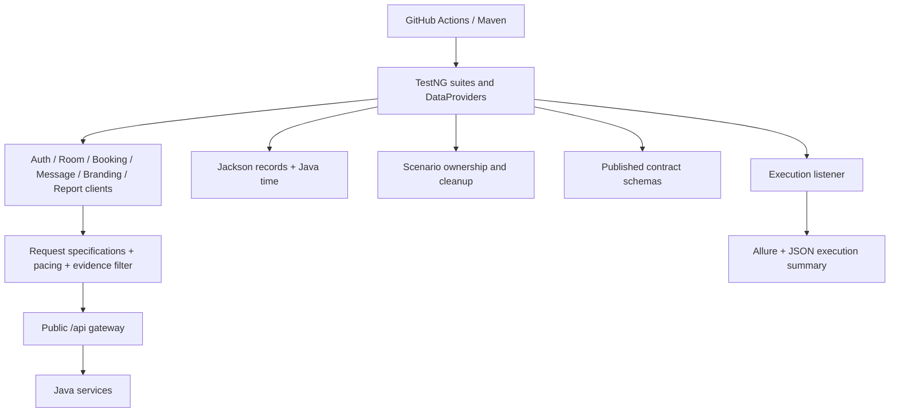

# Architecture

I separate transport construction from business assertions. Six service clients retain recognizable Rest Assured calls and encapsulate paths, cookies, query parameters, methods and JSON serialization. Tests assert status, persisted values and service relationships. `Specs` creates a fresh request specification for each request; it does not mutate global Rest Assured configuration.

`Config` resolves JVM system properties, then environment variables, then classpath properties. Dots in keys become underscores for environment variables (`base.uri` → `BASE_URI`). Credentials are deliberately different: they must come from `API_USERNAME` and `API_PASSWORD`, never a checked-in default. Login generates a fresh token within each scenario. No shared mutable token cache exists.

Jackson records model rooms, bookings, booking dates, message summaries, full messages, branding contact/address/map, reports and auth. Boxed IDs are omitted on create through NON_NULL serialization. JavaTimeModule serializes LocalDate as ISO dates. Unknown response properties are tolerated for additive server changes. `Specs.model` uses the same configured mapper for deserialization. Synthetic fixtures use UUID fragments, reserved `example.test` addresses and relative future dates.

`OwnedData` is an AutoCloseable scenario ledger. It records unique identities before sending creates, recovers server IDs through collection correlation, and performs cleanup when assertions throw. Room identity is rechecked before cleanup to avoid deleting a reused ID after a reset. Booking deletion is scoped to owned rooms and synthetic names. Message deletion uses exact owned subjects or generated booking identities. Cleanup attempts continue after individual failures and aggregate errors as suppressed exceptions; try-with-resources preserves the original assertion. Collection reads verify deletion because direct missing-room reads currently return a server error.

Evidence uses a ThreadLocal buffer. It stores only selected safe metadata and recursively sanitized JSON. Passwords, username, tokens, contact fields and personal name keys are redacted; cookies and authorization headers are never copied. Non-JSON bodies are omitted. The TestNG invocation hook attaches evidence before Allure closes a failing test. Logging emits the same sanitized evidence on failure. There is no default wire logger or built-in Rest Assured body logger.

A synchronized pacing gate spaces request starts by at least 300 ms across workers. Tests are sequential by default, DataProviders are sequential, and mutable scenarios hold only local state. Optional parallel methods must be limited to two workers against this public application. There are no retries, dependency-based test ordering, load tests or browser automation dependencies.
